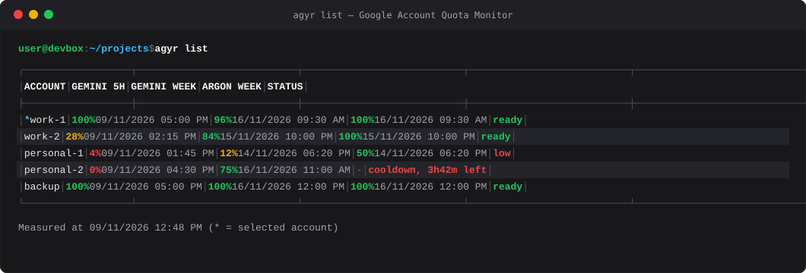

# agyr

Rotate seamlessly between multiple Google accounts for `agy` (Antigravity CLI / Google DeepMind coding agent) without hitting quota walls, and inspect each account's real quota in real time.



---

## 3 Core USPs (Unique Selling Points)

- **100% Local & Privacy-First**
  No external servers, no cloud middleman. Your OAuth tokens stay strictly on your local disk (`chmod 600`) or native OS credential store (Windows Credential Manager / Linux secret store). `agyr` never reads or sends your credentials anywhere.
- **Zero-Ban Risk**
  No reverse-engineered proxy server, no datacenter IP blacklists, and no TLS/HTTP fingerprint anomalies. `agyr` invokes the official `agy` binary directly with genuine client authentication.
- **Seamless Auto-Rotation on 429**
  Instantly detects 429 quota exhaustion, sets a precise cooldown based on Google's reset header, picks the ready account whose weekly limit resets soonest, and resumes the exact same conversation with `agy --conversation` without losing context.



---

## Why agyr? (Architecture Comparison)

| Feature | `agyr` (Native CLI Swapper) | Proxy Routers (e.g. `9router`) |
|:---|:---|:---|
| **Architecture** | **Direct local CLI execution** via official `agy` binary | Local/remote reverse HTTP/SOCKS proxy daemon |
| **Account Ban Risk** | **Zero** — Uses authentic Google CLI binary &amp; TLS fingerprints | **High** — Fake TLS fingerprints, cloud/datacenter IP flags |
| **Credential Privacy** | **100% Local** — Tokens stay `chmod 600` on your machine | Tokens intercepted or relayed through proxy daemon |
| **Antigravity CLI Updates** | **Immediate** — Compatible with official `agy` updates instantly | Frequently breaks whenever Google updates API schemas or SSE |
| **429 Failover &amp; Resume** | **Native resume** — Automatically resumes conversation context | Drops session or requires expensive prompt replay |
| **Resource Usage** | **Pure Bash** — 0 MB background RAM, no persistent daemon | Background Node.js / Go / Docker container running 24/7 |
| **Platform Support** | Linux (D-Bus keyring isolation) &amp; Windows (Credential Manager) | Varies; often requires complex Docker or loopback setups |

---

## Quick Installation

Requires `bash`, `git`, and `jq`.

### One-Line Install (Recommended)

```bash
curl -fsSL https://raw.githubusercontent.com/luongtrz/rotate-agy/main/install.sh | bash
```

To install into a custom directory (e.g., `~/bin`):
```bash
curl -fsSL https://raw.githubusercontent.com/luongtrz/rotate-agy/main/install.sh | bash -s -- ~/bin
```

### Manual Clone

```bash
git clone https://github.com/luongtrz/rotate-agy.git ~/tools/agy-acct

# Unified auto-detect installer (recommended):
bash ~/tools/agy-acct/install.sh

# Or invoke the specific platform installer directly:
bash ~/tools/agy-acct/platforms/linux/install.sh       # Linux: symlinks into ~/.local/bin
bash ~/tools/agy-acct/platforms/windows/install.sh     # Windows: Git Bash + .cmd wrappers into ~/.local/bin
```

AI agents installing this repository should follow [AGENT.MCP.md](AGENT.MCP.md).

---

## Platform Backends

- **Linux (`file` backend):** `agy` stores its login in the token file (`~/.gemini/antigravity-cli/antigravity-oauth-token`). `agyr` and `agy-run` isolate the GNOME keyring over D-Bus (`DBUS_SESSION_BUS_ADDRESS=unix:path=/nonexistent`) so `agy` reads the swapped token file instead of falling back to system keyring credentials.
- **Windows (`wincred` backend):** `agy` stores its login in Windows Credential Manager (`gemini:antigravity`). `agyr` swaps slots directly into Credential Manager. Both Git Bash shell scripts and Windows `.cmd` wrappers are generated, allowing `agyr`, `agy-run`, and `agy-task` to be invoked directly from Git Bash, Windows PowerShell, and Command Prompt (CMD).

---

## Command Reference

### Daily Account Management

```bash
agyr list                  # Show real-time quota table for all accounts (* = active; 0 tokens)
agyr list --claude         # Include Claude 5-hour and weekly quota columns
agyr list -w               # Wide format: prevent auto-collapsing optional model columns
agyr list -c               # Display cached quota data without making API calls
agyr use <name>            # Switch active account to <name>
agyr save <name>           # Save current interactive sign-in as an account slot
agyr swapui <n1> <n2>      # Swap UI display order of two accounts in 'agyr list' (--reset to restore)
agyr del <name>            # Permanently delete an account slot (alias: rm)
agyr rotate [cooldown]     # Manually rotate to the next ready account with cooldown
agyr test [name...]        # Send "Hi" to every account to start its 5-hour quota window
agyr forget                # Clear local active login before signing in to a new account
agyr help [command]        # Detailed command documentation
```

### Automation & AI Agents

- **`agy-run`**: Runs `agy` non-interactively with automatic 429 failover. When quota runs out, `agy-run` terminates the process immediately, sets account cooldown, switches to the next account whose weekly limit resets soonest, and resumes the exact same conversation.
- **`agy-task`**: Orchestrates coding tasks in dedicated, isolated git worktrees for AI orchestrators (Claude Code, Antigravity, Gemini).

---

## AI Agent Orchestration

`agyr` includes a first-class skill in `skills/agy/` designed for Claude Code, Antigravity, and Gemini agents to delegate implementation and investigation tasks to `agy` as a sub-agent.

For complete setup instructions, see:
- [docs/agent-setup.md](docs/agent-setup.md): Configure `CLAUDE.md`, `GEMINI.md`, and `AGENTS.md`.
- [AGENT.MCP.md](AGENT.MCP.md): Agent setup and verification protocol.

---

## Getting Started (Adding Accounts)

1. **Sign in and save your first Google account:**
   ```bash
   agyr              # Opens your browser to sign in to Google account #1
   agyr save acc1    # Saves the current login into slot 'acc1'
   ```

2. **Add a second account (and any additional accounts):**
   ```bash
   agyr forget       # Clears the active local login (slot 'acc1' stays safe)
   agyr              # Opens your browser to sign in to Google account #2
   agyr save acc2    # Saves the login into slot 'acc2'
   ```

3. **Inspect real-time quota status across all slots:**
   ```bash
   agyr list         # Live quota table: green (high), yellow (medium), red (low/cooldown)
   ```

4. **Switch accounts manually (for interactive sessions):**
   ```bash
   agyr use acc1     # Switch to acc1
   agyr use acc2     # Switch to acc2
   ```

5. **Run automated tasks with seamless 429 failover:**
   ```bash
   # Automatically rotates accounts on 429 and resumes the same conversation:
   agy-run --add-dir . --prompt "Write unit tests for the auth service"
   ```

---

## Documentation

- [docs/reference.md](docs/reference.md): In-depth technical architecture, full command specifications, Linux and Windows platform backends, environment variables, known limitations.
- [docs/agent-setup.md](docs/agent-setup.md): Complete guide to installing `skills/agy` and configuring AI orchestrators.
- [AGENT.MCP.md](AGENT.MCP.md): Guide for AI agents installing and verifying `agyr`.

---

## Repository Layout

- `bin/`: `agyr`, `agy-run`, `agy-task` executables.
- `install.sh`: Unified installer (supports both local execution and `curl ... | bash` piping).
- `platforms/linux/`: Linux platform backend (D-Bus keyring bypass, symlink installer).
- `platforms/windows/`: Windows platform backend (`wincred`, Credential Manager helpers, Git Bash + `.cmd` wrappers).
- `skills/agy/`: AI agent skill for delegating tasks via `agy-task` and `agy-run`.
- `templates/`: Templates used by `agy-task` (`hard-rules.txt`, `agy-task.conf.example`).
- `docs/`: Technical reference (`reference.md`), orchestrator guide (`agent-setup.md`), and visual assets (`docs/assets/`).
- `test/`: Test runner (`run.sh`), shared core suite (`core.sh`), and platform suites (`linux.sh`, `windows.sh`).

---

## Tests

The test suite runs with fake tokens and a simulated `agy` binary; it never modifies real user credentials or consumes Google quota.

```bash
bash test/run.sh              # Run all suites (core + linux + windows; 930+ checks, never touches real logins)
bash test/run.sh core         # Run platform-independent core tests
bash test/run.sh linux        # Run Linux platform tests
bash test/run.sh windows      # Run Windows platform tests
```

---

## Support

`agyr` is free and open source under the MIT license: no paywall, no accounts, no telemetry. If it saves you time and you want to support development, you can [buy me a coffee](https://buymeacoffee.com/luongtrz). It is entirely optional; starring the repo and reporting issues help just as much.

---

## License

MIT, see [LICENSE](LICENSE).
